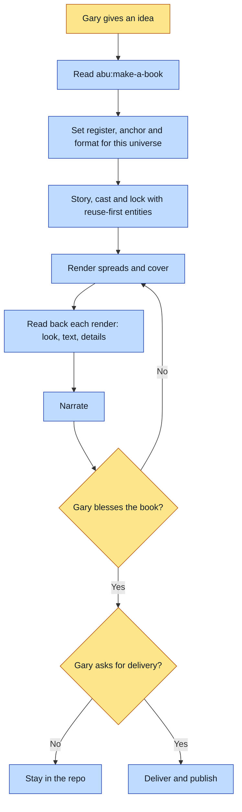

# Purpose
This skill makes a picture book in the HYPERAGENTIC AGE universe. The look is warm editorial
ink-and-wash. The recurring image is a glowing laptop, with a person wielding a fleet of agents.
The skill is a thin layer. It holds only the facts of this universe. The base skill
`abu:make-a-book` runs the actual steps in order.

# When to use (Trigger)
Gary asks for a hyperagent book, a new book in the hyperagent universe, a HYPERAGENTIC AGE book
about a topic, or types `/make-a-hyperagent-book {idea}`. Not for a new universe (use
`abu:start-new-story-universe`) and not for editing an existing book (use `abu:update-book`).

# Inputs / Prerequisites
- The idea for the book.
- The universe folder `hyperagentic-age/universe`, the folder that holds `universe.json`.
- The base skill `abu:make-a-book`, read first. It owns the order of steps, the auto-advance policy, the two real gates, the environment, the render gotchas, and merging the work home.
- For a real person in the book: a photo stack (a non-empty list of files) and an approval state of `gated` or `approved`.

# Roles
| Role | Responsibility |
|---|---|
| **Human operator** | Supplies the idea. Blesses the finished book. Asks for delivery. Settles the two real gates that the base skill defines. |
| **Agent executor** | Follows `abu:make-a-book` with this universe's facts: register, format, mark, law, and entities. |

# Procedure
The order of steps belongs to `abu:make-a-book`: story, cast, lock, render, cover, narrate, deliver, publish. The steps below are what this universe adds.
1. Read `abu:make-a-book` and follow it. Point it at the universe folder above.
2. Keep to the register: warm editorial, soft and illustrative. Reject neo-comic, HUD and arc-reactor looks, neon, 3D or Pixar looks, and glossy plastic.
3. Use the content-neutral swatch at `reference/style/warm-editorial-neutral/` as the style anchor. Never use a character portrait as the anchor. If the book has no recurring person, pass only that anchor and the entity masters it needs.
4. Default the format to landscape full-spread, `1536x1024`, with `layout: "full-spread"`. Choose portrait art-and-text only on purpose, for a close single-character primer.
5. For full-spread pages, keep the bottom right calm, because the caption card sits there. Set the caption position per spread (`top` when the bottom is busy). Keep the key element off the dead center, where the gutter splits the image.
6. Reuse existing entities first: `gary`, `chief-of-agents`, `sub-agent`, `maya`, `chrissy`, `engineer`, the `winged-startup` motif, and the plates and laws. Name every small locked detail in the prompt, such as the two chest patches on `gary`.
7. Pick the rising motif from what the story is made of. Do not use the winged-startup block-stack as a generic hopeful motif.
8. Apply the universe law. Real people are a stylized editorial likeness in the spreads, never photoreal. Their reference sheets are shot hyper-real and register-neutral by default. Public figures may be published. Check the entity's own approval note before inventing a hold. Use public professional persona only, and nothing private.
9. Text inside the art is welcome. Quote the exact string in the prompt. Spell-check it at crop zoom on read-back. Regenerate from scratch on any error. The book `the-constitution` is the exception and shows abstract marks, never readable text.
10. The renderer stamps the back matter mark: `A HYPERAGENTIC AGE story`.
11. Deliver to books.garysheng.com through the platform-delivery skill only when the book is blessed and Gary asks. Books about real people are private by default.
12. For a later art-only change to one slot, run the reroll command from the recipe file beside the asset. It needs no canon reads.

# Process Flowchart

# Done / Verification
- The universe's checks pass, as the base skill requires.
- Every render was read back against its entity details, and any in-art text was spell-checked.
- Gary has blessed the book before any delivery.
- The skill names no other check beyond those of the base skill.

# Exceptions & Troubleshooting
- **A character portrait leaked into other pages.** The anchor was a portrait. Swap it for the neutral swatch.
- **A locked detail dropped.** The prompt left out a small invariant. Name every one.
- **A string photo stack on a real person gives many false errors.** The photo stack must be a non-empty list of files. Do not add the real-person block until the photos exist.
- **Layout came out portrait by habit.** Default to landscape full-spread.
- **An era-specific look is wrong.** When a book spans a life, check every beat for the era it belongs to when the look is created.
- **A lesson true in any universe.** Put it in the base skill, not here.

# Automation Opportunities
- Art-only changes to one slot already have a one-command replay.
- The base skill auto-advances between steps. The two real gates stay with Gary.

# Related
- `abu:make-a-book`: the base chain this skill sits on.
- `abu:update-book`: edits to an existing book.
- `abu:start-new-story-universe`: a brand-new universe.
- `abu:reroll-slot`: art-only replay from a recipe.

# Revision History
| Version | Date | Change |
|---|---|---|
| 0.1 | 2026-11-06 | Drafted from SKILL.md. |
